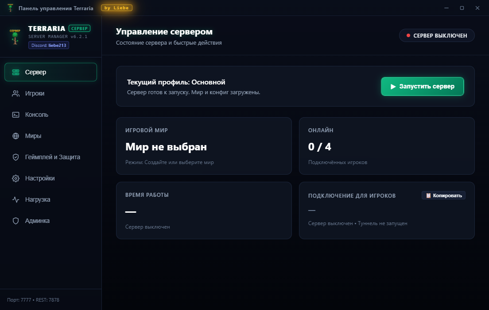
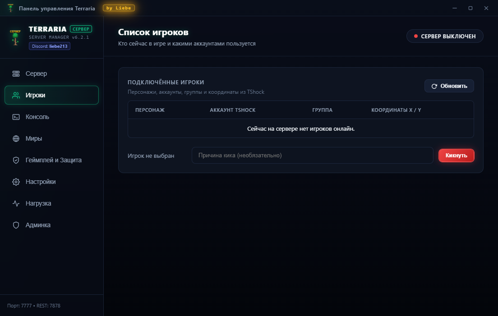
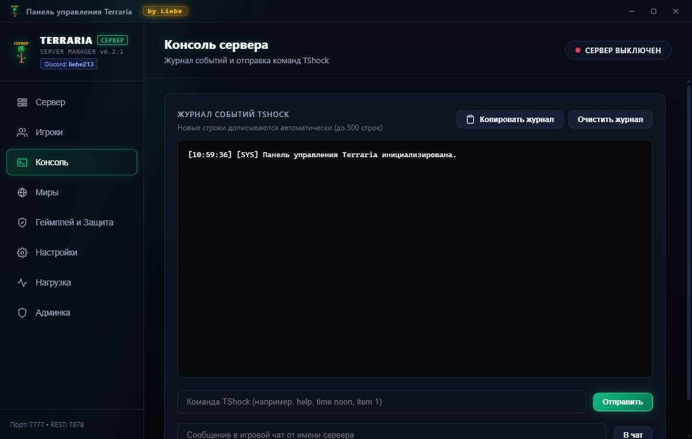
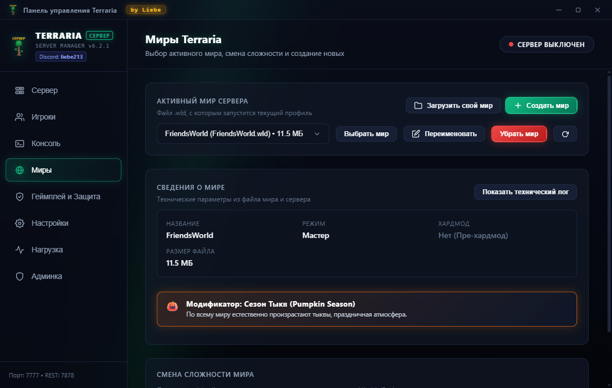
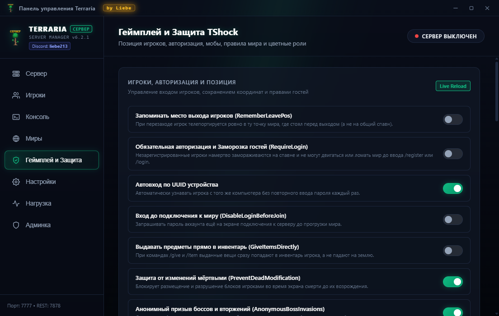
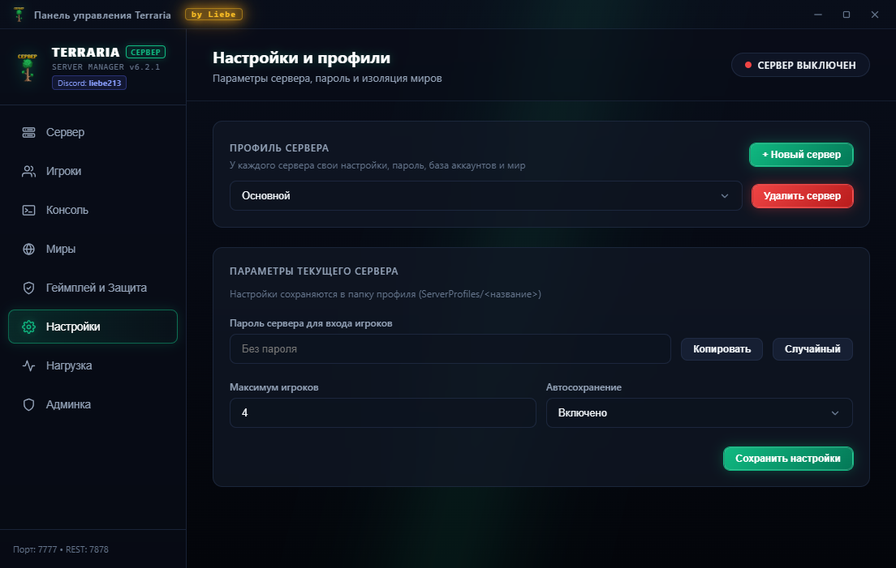
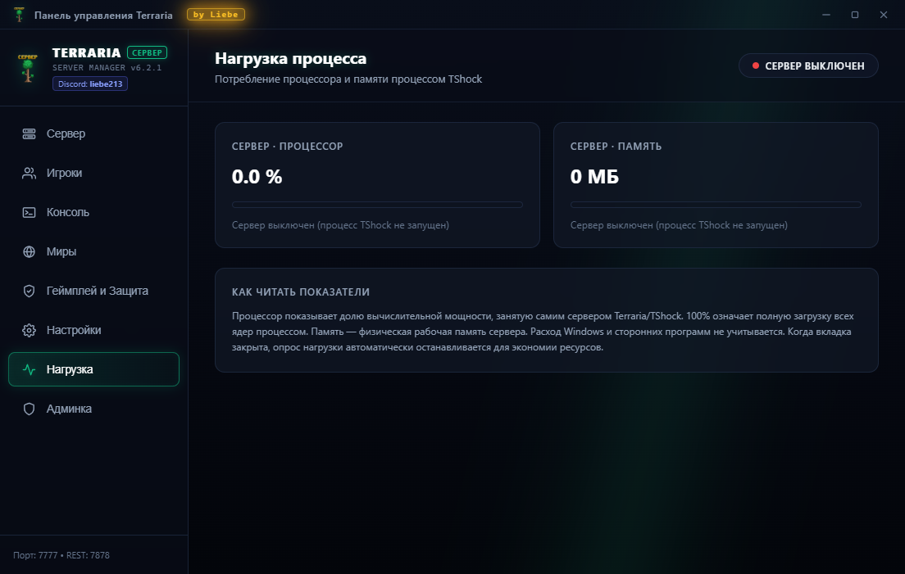
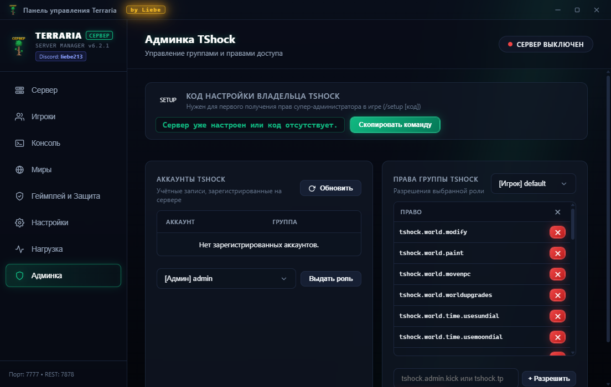

# 🌲 Terraria & TShock Server Manager
> **Современная кибер-панель управления сервером Terraria 1.4.5.8 & TShock 6.2.1**  
> *Разработано: **Liebe** (Discord: `liebe213`)*

[](https://terraria.org/)
[](https://github.com/Pryaxis/TShock)
[](https://python.org)
[](#галерея-всех-вкладок)
[]()

---

## 📸 Галерея всех вкладок панели

### 1. 🖥️ Сервер — Главная панель и быстрые действия
> Состояние сервера, время работы, туннель Playit.gg для друзей без белого IP и переключение профилей.


---

### 2. 👥 Игроки — Список онлайн и управление
> Мониторинг подключённых игроков, назначение ролей, быстрый кик и телепортация.


---

### 3. 💻 Консоль — Живой терминал TShock
> Полнофункциональный журнал сервера в реальном времени с цветовой разметкой, отправкой команд TShock и сообщений в чат.


---

### 4. 🌍 Миры — Менеджер и расширенный генератор
> Выбор активного мира, смена сложности (Классика / Эксперт / Мастер / Путешествие), генерация секретных сидов (*Zenith / Get Fixed Boi, Drunk World, For The Worthy, Don't Dig Up*) и автоматические бэкапы.


---

### 5. ⚔️ Геймплей и Защита — Безопасность сервера
> Тонкая настройка защиты от гриферов, блокировка взрывов, сохранение инвентаря на сервере (SSC), белые списки и правила.


---

### 6. ⚙️ Настройки — Конфигурация портов и сети
> Управление игровым портом (7777), REST API портом (7878), паролями, слотами и путями к файлам.


---

### 7. 📊 Нагрузка — Мониторинг ресурсов
> Высокоточный отслеживатель потребления процессора и оперативной памяти выделенного процесса Terraria/TShock в реальном времени.


---

### 8. 🛡️ Админка — Управление TShock и правами групп
> Получение одноразового `/setup` кода владельца, редактирование ролей (`owner`, `admin`, `superadmin`, `default`), создание персональных групп и точечная настройка сотен прав доступа TShock.


---

## ⚡ Особенности и возможности

- **🎮 Абсолютная автономность**: Для работы не требуется вручную устанавливать Python, базы данных или .NET Runtime — всё упаковано в портативный вид.
- **🌐 Встроенная Web-панель**: Модуль в папке `Panel/Browser` позволяет управлять сервером удалённо с телефона или планшета через браузер.
- **🔄 Серверные профили**: Возможность переключаться между разными мирами и конфигурациями в один клик.
- **🚀 Интеграция с Playit.gg**: Подключение друзей через безопасный туннель без необходимости открывать порты на роутере.
- **🖱️ Удобная навигация**: Поддержка аппаратных боковых кнопок мыши `Mouse4` (Назад) и `Mouse5` (Вперёд).
- **✨ Кибер-дизайн**: Анимированные неоновые лучи, интерактивный Spotlight карточек и стеклянный эффект размытия (Glassmorphism).

---

## 🚀 Быстрый старт

1. Скачайте последний релиз из раздела [Releases](https://github.com/Liebezx/Terraria-Server-Panel/releases).
2. Распакуйте архив в любую папку.
3. Запустите **`Запустить Панель.exe`** (или `Запустить Панель.bat`).
4. Выберите нужный мир во вкладке **Миры** и нажмите **«Запустить сервер»**!

---

## 🛠️ Запуск из исходного кода (для разработчиков)

```bash
# Установка необходимых зависимостей
pip install pywebview pillow requests psutil

# Запуск панели управления
python "Panel/TerrariaPanel.pyw"
```

---

## 👤 Авторство
- **Разработчик:** Liebe
- **Discord:** `liebe213`
