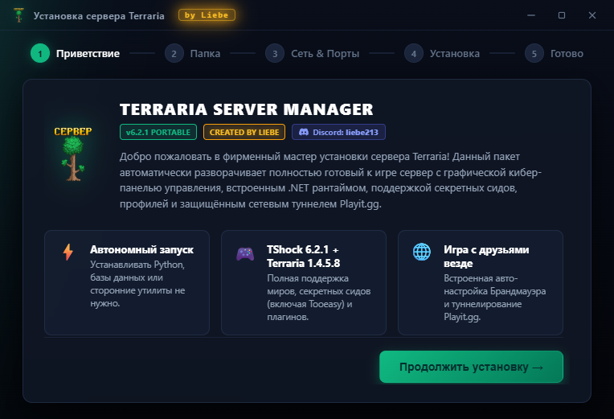

# 🌲 Terraria & TShock Server Manager
> **Автономный серверный комплекс Terraria 1.4.5.8 & TShock 6.2.1 с кибер-панелью управления и встроенным туннелем Playit.gg**  
> *Разработчик: **Liebe** (Discord: `liebe213`)*

[-8b5cf6.svg)](https://playit.gg)

> 🌐 **Играйте с друзьями без белого IP и без открытия портов:**  
> В серверный комплекс глубоко интегрирован сервис **Playit.gg**. Вам больше не нужно разбираться в настройках роутера, звонить провайдеру ради статического IP или использовать сторонние программы вроде Hamachi/Radmin. Панель всё делает автоматически: при запуске генерируется индивидуальный защищённый адрес подключения, который друзья просто вводят в игре!

---

## ⚡ Фирменный мастер установки (Setup Wizard)

Комплекс поставляется в виде единого автономного установщика **`Terraria_Server_Setup.exe`**, который автоматически настраивает брандмауэр Windows, службу Playit.gg, выводит ярлыки на рабочий стол и подготавливает всё к мгновенному старту.

### 📥 [Скачать официальный установщик (Terraria_Server_Setup.exe)](https://github.com/Liebezx/Terraria-Server-Panel/releases/latest)

---

## 🌐 Как устроено подключение друзей через Playit.gg

1. **Без белого IP и проброса портов**:
   Туннель работает через протокол **Playit.gg**, пробивая любые типы NAT и работая даже на мобильном интернете или через провайдерский «серый» IP.
2. **Копирование адреса в 1 клик**:
   На главной вкладке панели в блоке *«Подключение для игроков»* отображается ваш персональный адрес туннеля (вида `*.ply.gg:порт`). Нажмите кнопку **«📋 Копировать»** и отправьте его друзьям.
3. **Как подключиться другу**:
   В меню Terraria нажать: **Многопользовательская игра** ➔ **Подключиться по IP** ➔ ввести выданный адрес и играть вместе!
4. **Кроссплей**:
   Поддерживается подключение как с ПК, так и со смартфонов (Android / iOS) с идентичной версией Terraria 1.4.5.8.

---

## 📸 Галерея всех вкладок панели

### 1. 🖥️ Сервер — Главная панель и быстрые действия
> Состояние сервера, время работы, туннель Playit.gg для подключения друзей и переключение профилей.

---

### 2. 👥 Игроки — Список онлайн и управление
> Мониторинг подключённых игроков, назначение ролей, быстрый кик и телепортация.

---

### 3. 💻 Консоль — Живой терминал TShock
> Полнофункциональный журнал сервера в реальном времени с цветовой разметкой, отправкой команд TShock и сообщений в чат.

---

### 4. 🌍 Миры — Менеджер и расширенный генератор
> Выбор активного мира, смена сложности (Классика / Эксперт / Мастер / Путешествие), генерация секретных сидов (*Zenith / Get Fixed Boi, Drunk World, For The Worthy, Don't Dig Up*) и автоматические бэкапы.

---

### 5. ⚔️ Геймплей и Защита — Безопасность сервера
> Тонкая настройка защиты от гриферов, блокировка взрывов, сохранение инвентаря на сервере (SSC), белые списки и правила.

---

### 6. ⚙️ Настройки — Конфигурация портов и сети
> Управление игровым портом (7777), REST API портом (7878), паролями, слотами и путями к файлам.

---

### 7. 📊 Нагрузка — Мониторинг ресурсов
> Высокоточный отслеживатель потребления процессора и оперативной памяти выделенного процесса Terraria/TShock в реальном времени.

---

### 8. 🛡️ Админка — Управление TShock и правами групп
> Получение одноразового `/setup` кода владельца, редактирование ролей (`owner`, `admin`, `superadmin`, `default`), создание персональных групп и точечная настройка сотен прав доступа TShock.

---

## 🚀 Установка и быстрый старт

1. Скачайте **`Terraria_Server_Setup.exe`** из раздела [Релизы](https://github.com/Liebezx/Terraria-Server-Panel/releases).
2. Запустите мастер установки и следуйте подсказкам на экране.
3. По завершении на Рабочем столе появится ярлык **«Панель Terraria»**.
4. Запустите панель, создайте или выберите мир во вкладке **Миры** и нажмите **«Запустить сервер»**!

---

## 🌟 Ключевые возможности
- **Полная автономность**: Не требует предварительной установки Python, .NET Runtime или баз данных.
- **Встроенный Playit.gg**: Игра с друзьями через защищённый туннель без открытия портов.
- **Удалённый доступ**: Встроенная Web-панель для мониторинга сервера с телефона или планшета через браузер.
- **Безопасность**: Защита настроек и профилей игроков.

---

## 👤 Автор проекта
- **Разработчик:** Liebe
- **Discord для связи:** `liebe213`
